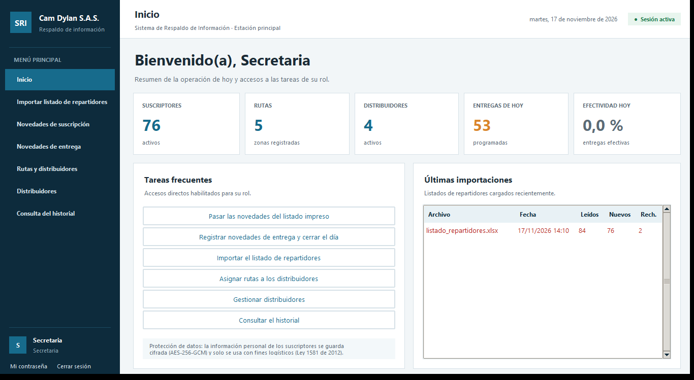

# SRI · Sistema de Respaldo de Información

Aplicación de escritorio para **Distribuciones Cam Dylan S.A.S.** que consolida el listado de repartidores de la empresa y las novedades que la editorial entrega en listados impresos, gestiona distribuidores y rutas, registra las novedades de entrega, conserva el historial en una base local cifrada, genera el reporte diario de entregas y hace un respaldo cifrado cada día con copia semanal en Google Drive.

Proyecto Integrador · Universidad de Santander · 2026. Alineado con el informe **Avance_informe_proyecto1_v5.3**.



## 1. Alcance implementado

| Requisito | Descripción | Estado |
|---|---|---|
| RF-01 | Importar el listado de repartidores tal como lo tiene la empresa (una hoja por distribuidor, listas lado a lado, N°/TIE/ruta sin encabezado): separar la periodicidad del nombre, productos TIE/PT, código de ruta → distribuidor, suscriptores con dos direcciones, rechazos justificados y casos para revisar | Implementado |
| RF-02 | Asignar y modificar rutas (una ruta, un distribuidor) y generar la **ruta imprimible** por distribuidor | Implementado |
| RF-03 | Reporte diario de entregas **programadas**, efectividad y novedades del día, exportable a CSV y HTML/PDF | Implementado |
| RF-04 | Gestionar distribuidores (crear, consultar, actualizar y dar de baja) | Implementado |
| RF-05 | Registrar las novedades de entrega y **cerrar el día** | Implementado |
| RF-06 | Consultar el historial de suscriptores, rutas y entregas con filtros | Implementado |
| RF-07 | **Respaldo diario automático** (se conservan 7), **copia a Google Drive**, avisos y restauración | Implementado |
| RF-08 | Iniciar sesión y habilitar funciones según el rol | Implementado |
| RF-09 | Registrar **novedades de suscripción** (ingresos, retiros y cambios) del listado impreso | Implementado |

Las doce reglas de negocio (RN-01 a RN-12) se validan en la capa de servicios y en la base de datos. La matriz de trazabilidad y los cambios frente al informe v3.1 están en [`docs/ENTREGABLE.md`](docs/ENTREGABLE.md).

## 2. Tecnologías

- **Python 3.11+** (probado con Python 3.14 en Windows 11), **Tkinter / ttk** y **SQLite**.
- **openpyxl** y **xlrd** para leer `.xlsx` y `.xls` (también admite `.csv`).
- **cryptography** para AES-256-GCM; `hashlib`/`hmac` para PBKDF2-SHA256 e índice ciego.
- Interfaz en español, fechas `dd/mm/aaaa` y tipografía ampliada.

> El informe (Tabla 20) propone Java/JavaFX/JDBC/BCrypt/JasperReports/JUnit. El prototipo mantiene la arquitectura del informe con otra tecnología; ver las limitaciones de `docs/ENTREGABLE.md`.

## 3. Instalación y ejecución

```bat
cd sri_cam_dylan
python -m venv .venv
.venv\Scripts\activate
pip install -r requirements.txt
run.bat
```

o bien `python main.py`. La primera ejecución crea `datos/sri_cam_dylan.db`, la clave local `datos/sri.key` y los usuarios iniciales. Una base creada con la versión anterior del prototipo se actualiza sola al abrirla.

| Usuario | Contraseña | Rol | Funciones |
|---|---|---|---|
| `secretaria` | `Sri2026*` | Secretaría | Importar listado, novedades de suscripción y de entrega, rutas, distribuidores e historial |
| `gerencia` | `Sri2026*` | Gerencia | Reporte diario, historial y respaldos |

> Cambie estas contraseñas desde **Mi contraseña** antes de usar el sistema con datos reales.

## 4. Datos de demostración

| Archivo | Uso |
|---|---|
| `datos_ejemplo/listado_repartidores.xlsx` | Carga inicial: 5 hojas (incluida una hoja repetida), 84 filas, 2 rechazos y 3 casos para revisar (código «AL» de un distribuidor retirado, periodicidad «quincenal», suscriptor con oficina y casa) |
| `datos_ejemplo/listado_repartidores_actualizado.xlsx` | Recarga en vivo con 2 suscriptores nuevos |

### Kit de prueba

Para aprender a usar el SRI sin tocar los datos reales, abra `kit_de_prueba\abrir_SRI_de_prueba.bat`: usa una base aparte dentro de `kit_de_prueba\prueba`. La carpeta trae cinco listados para probar la importación (carga inicial, recarga, columna extra, sin columnas y archivo dañado). Para empezar de cero, ejecute `borrar_prueba_y_empezar_de_cero.bat`. Los pasos están en la guía de prueba paso a paso.

La base de demostración contiene 76 suscriptores activos, 5 rutas, 4 distribuidores, una semana de días cerrados con novedades de entrega, las novedades del listado impreso de hoy (1 ingreso, 1 retiro y 1 cambio), un respaldo manual y el respaldo diario.

```bat
python herramientas\preparar_demo.py --reiniciar
```

> **Paquete `.rar`:** por seguridad no incluye la clave `datos/sri.key`. Por eso tampoco trae la base demo ni los respaldos, que sin esa clave no se pueden leer. Después de instalar, ejecute `python herramientas\preparar_demo.py` una vez: crea una clave nueva, la base de demostración y los respaldos.

> **Advertencia:** `--reiniciar` elimina la base de datos actual (conserva la clave). No lo ejecute sobre información real.

## 5. Estructura del proyecto

```text
sri_cam_dylan/
├── main.py · run.bat · config.json · requirements.txt
├── sri/
│   ├── contexto.py             Composición de dependencias
│   ├── seguridad.py            AES-256-GCM, índice ciego y contraseñas
│   ├── config.py · util.py     Configuración, validaciones y fechas
│   ├── dominio/                Entidades, permisos y periodicidad
│   ├── datos/                  Esquema SQL, migración, conexión y DAO
│   ├── servicios/              Autenticación, importación, suscripciones, operación, consultas, respaldos, auditoría
│   └── presentacion/           Login, menú por rol y vistas
├── pruebas/test_sri.py         31 pruebas automatizadas
├── herramientas/               Generación del listado de ejemplo y preparación de la demo
├── datos_ejemplo/              Listados de repartidores de ejemplo
├── kit_de_prueba/              Base de prueba aparte y listados para probar la importación
├── datos/                      Base SQLite y clave local (no versionar)
├── respaldos/                  Respaldos .sribak (diarios y manuales)
├── exportes/                   Reportes y rutas imprimibles
└── docs/                       Manual, arquitectura, trazabilidad, guion y capturas
```

## 6. Pruebas automatizadas

```bat
python -m unittest discover -s pruebas -v
```

Resultado esperado: **31 pruebas OK**. Cubren autenticación, permisos, contraseñas y bitácora; periodicidad; importación multihoja con el formato real (listas lado a lado, columnas sin encabezado y aviso de datos sin leer), dos direcciones, códigos de ruta, archivo dañado y CSV; novedades de suscripción (ingreso, retiro, cambio); programación y cierre del día; reporte sobre programadas y exportes; ruta imprimible; búsqueda sobre datos cifrados; respaldo diario, retención de 7, Google Drive, verificación de respaldos, copia de la clave, avisos y restauración; consulta de suscriptores sin entregas y ficha con su estado; depuración anual; migración de la base anterior, y rendimiento RNF-02 (10 000 registros en ≈2,2 s; una novedad en < 2 s).

Las pruebas usan bases temporales y nunca modifican la base de demostración.

## 7. Seguridad y privacidad

- Nombre, direcciones (entre semana y fin de semana) y novedades del suscriptor se guardan **cifrados con AES-256-GCM**; también las novedades de entrega y de suscripción.
- Los duplicados se detectan con un **índice ciego HMAC-SHA256**, sin descifrar.
- Contraseñas con **PBKDF2-HMAC-SHA256** (240 000 iteraciones y sal aleatoria).
- Los respaldos `.sribak` (incluida la copia en Google Drive) van cifrados y se validan con `PRAGMA integrity_check` antes de restaurar.
- La clave `datos/sri.key` es imprescindible y debe custodiarse por separado: sin ella no se pueden leer los datos ni los respaldos.
- La bitácora registra operaciones y totales, **sin** nombres ni direcciones. La ruta impresa lleva el aviso de la Ley 1581 de 2012.

## 8. Documentación

- [`docs/MANUAL_USUARIO.md`](docs/MANUAL_USUARIO.md): rutina diaria y uso de cada pantalla, con capturas.
- [`docs/ARQUITECTURA.md`](docs/ARQUITECTURA.md): capas, flujos, modelo de datos, seguridad y decisiones.
- [`docs/ENTREGABLE.md`](docs/ENTREGABLE.md): cambios v3.1 → v5.3, matriz RF/RN → código/pruebas y verificación.
- [`docs/GUION_SUSTENTACION.md`](docs/GUION_SUSTENTACION.md): guion de exposición y demostración.

## 9. Limitaciones y trabajo futuro

- Estación local, un usuario a la vez; sin servidor central.
- La copia a Google Drive se hace en la carpeta sincronizada por Google Drive para escritorio; la subida automática por API queda como evolución.
- El respaldo diario se genera al cerrar el día, la sesión o la aplicación; no hay programador del sistema operativo.
- La unión de un suscriptor con dos direcciones se basa en el nombre y periodicidades complementarias; por eso queda en los casos para revisar.
- La exportación a PDF se hace desde el HTML con el navegador.
- RNF-02 y RNF-04 se verificaron con datos sintéticos; falta repetirlos con el listado real anonimizado en el computador de la gerente.
