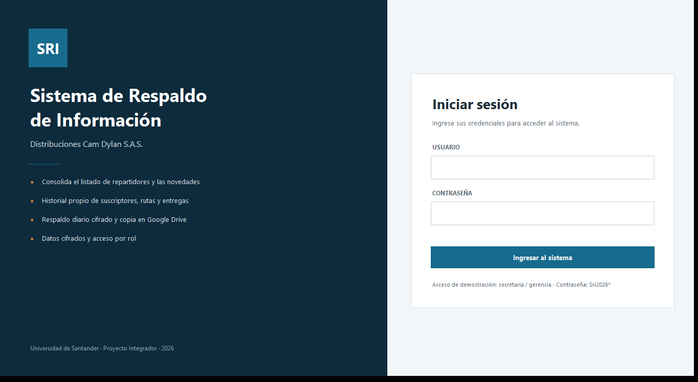
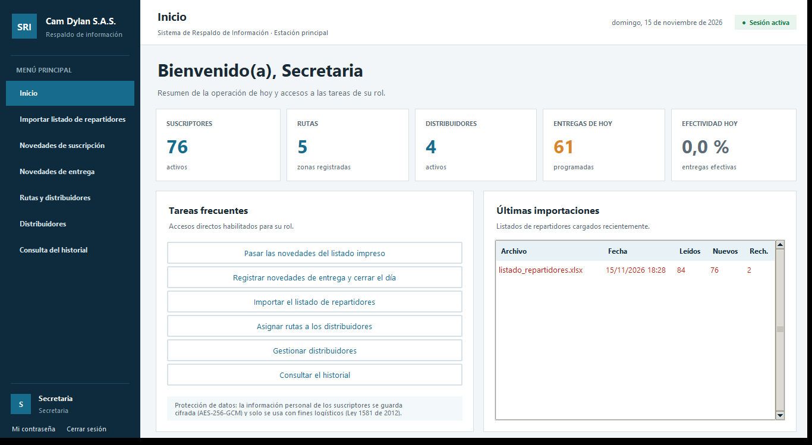
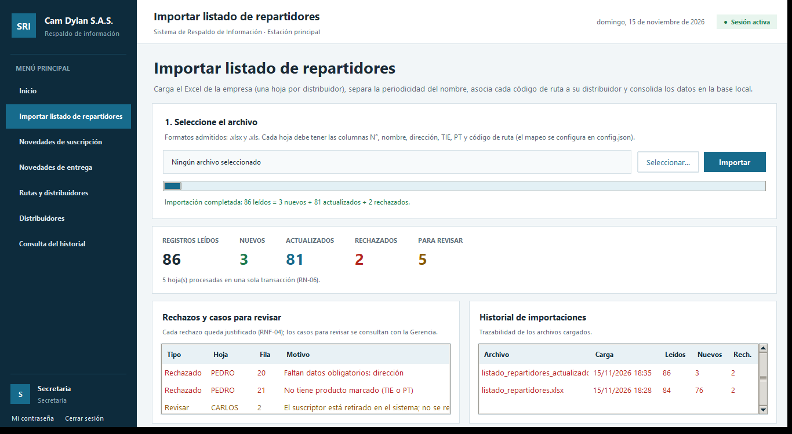
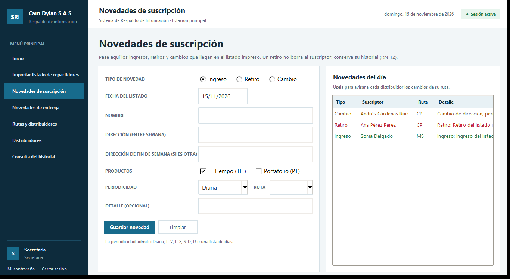
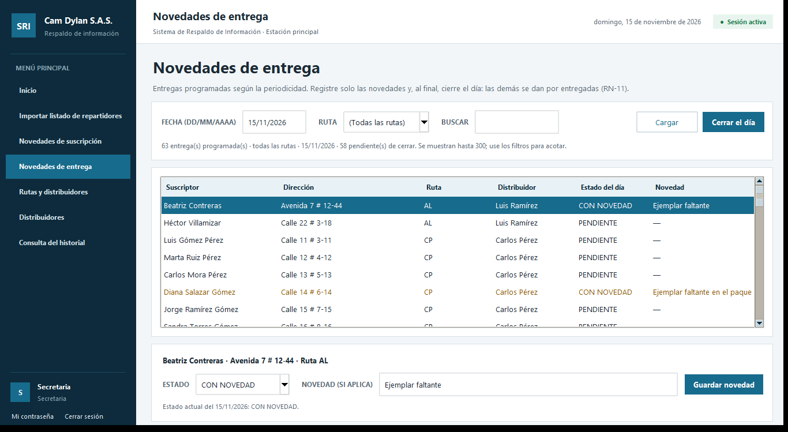
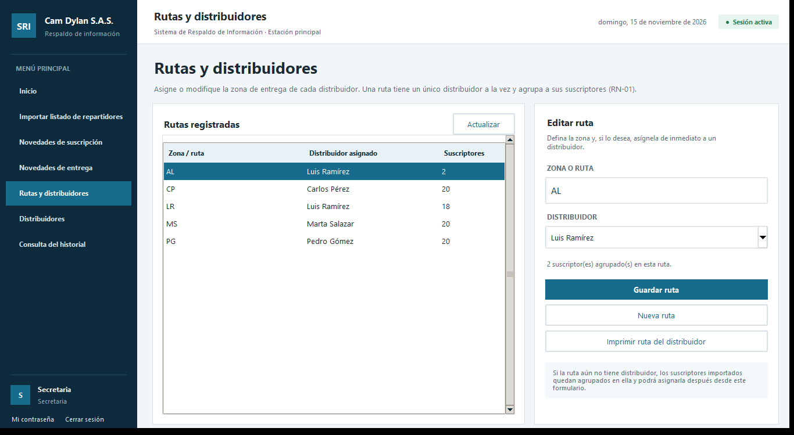
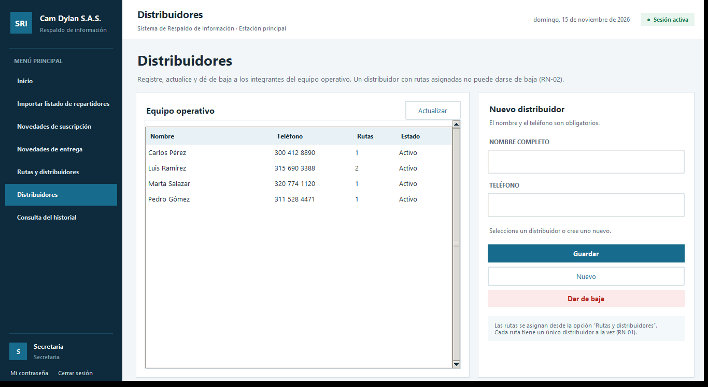
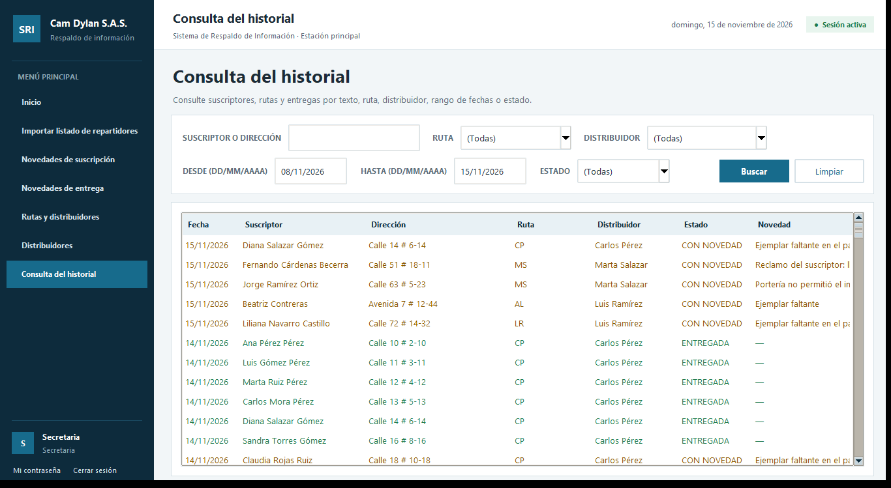
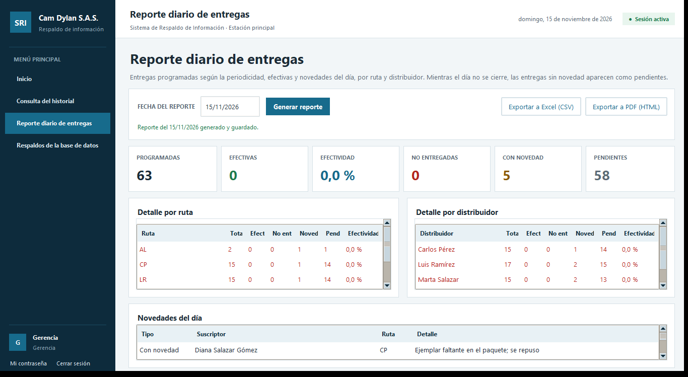
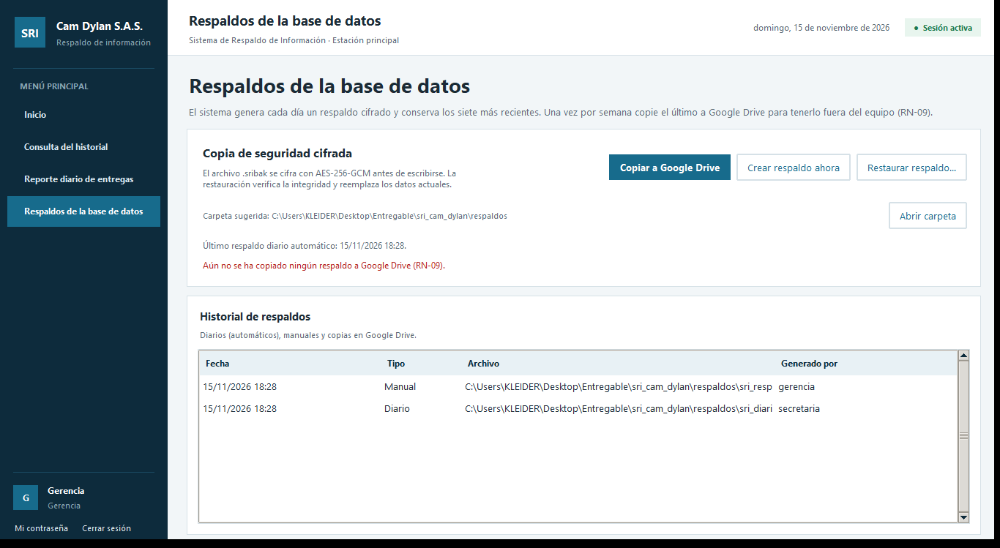

# Manual de usuario · SRI

**Sistema de Respaldo de Información — Distribuciones Cam Dylan S.A.S.**

Este manual describe el uso diario de la aplicación para los dos roles del proyecto: **Secretaría** y **Gerencia**. En la empresa ambos roles los ejerce la gerente: entre con el usuario `secretaria` para la operación diaria y con `gerencia` para los reportes y los respaldos. Todas las fechas se escriben y se muestran como `dd/mm/aaaa`.

---

## 1. Antes de empezar

1. Instale las dependencias una sola vez:

   ```bat
   cd sri_cam_dylan
   python -m venv .venv
   .venv\Scripts\activate
   pip install -r requirements.txt
   ```

2. Inicie la aplicación con `run.bat` o con `python main.py`.
3. La primera ejecución crea la base de datos, la clave de cifrado y los usuarios de demostración.

> La base de demostración trae 76 suscriptores activos en 5 rutas, 4 distribuidores, una semana de entregas cerradas y las novedades del listado impreso de hoy.

### La rutina de cada día

| Momento | Quién | Pantalla |
|---|---|---|
| Llega la prensa con el listado impreso | Secretaría | **Novedades de suscripción**: pasar ingresos, retiros y cambios |
| Los distribuidores reportan por WhatsApp o llamada | Secretaría | **Novedades de entrega**: registrar solo lo que reportan |
| Fin de la jornada | Secretaría | **Novedades de entrega → Cerrar el día** (genera el respaldo diario) |
| Una vez por semana | Gerencia | **Respaldos → Copiar a Google Drive** |
| Cuando se necesite | Gerencia | **Reporte diario de entregas** |

---

## 2. Inicio de sesión (RF-08)



1. Escriba el **usuario** y la **contraseña**.
2. Pulse **Ingresar al sistema** o presione `Enter`.
3. Si los datos son incorrectos, el sistema muestra un mensaje genérico: *«Usuario o contraseña incorrectos»*.
4. Si el último respaldo automático falló o hace más de siete días que no se copia un respaldo a Google Drive, aparece un **aviso de respaldos** al entrar (RF-07).

| Usuario | Contraseña | Rol |
|---|---|---|
| `secretaria` | `Sri2026*` | Secretaría |
| `gerencia` | `Sri2026*` | Gerencia |

| Función | Secretaría | Gerencia |
|---|:---:|:---:|
| Importar el listado de repartidores (RF-01) | Sí | No |
| Novedades de suscripción (RF-09) | Sí | No |
| Novedades de entrega y cierre del día (RF-05) | Sí | No |
| Rutas y ruta imprimible (RF-02) | Sí | No |
| Distribuidores (RF-04) | Sí | No |
| Consultar historial (RF-06) | Sí | Sí |
| Reporte diario de entregas (RF-03) | No | Sí |
| Respaldos, Google Drive y restauración (RF-07) | No | Sí |

**Cambiar la contraseña:** pulse **Mi contraseña** en la parte inferior del menú, escriba la actual y la nueva (mínimo 8 caracteres). Cambie `Sri2026*` antes de cargar información real.

---

## 3. Pantalla de inicio



- **Suscriptores**: suscriptores activos (los retirados no cuentan).
- **Rutas** y **Distribuidores** activos.
- **Entregas de hoy**: entregas **programadas** para hoy según la periodicidad de cada suscriptor.
- **Efectividad hoy**: entregadas ÷ programadas. Mientras el día no se cierre, las entregas sin novedad cuentan como pendientes.
- **Tareas frecuentes** y **Últimas importaciones**.

---

## 4. Importar el listado de repartidores (RF-01)



Se usa para la **carga inicial** del Excel de la empresa y, si hace falta, para volver a cargar el listado completo. Las novedades del día a día **no** se importan: se registran en **Novedades de suscripción**.

### 4.1 Cómo debe estar el archivo

Un libro `.xlsx` o `.xls` con **una hoja por distribuidor** y estas columnas en cada hoja:

| N° | NOMBRE | DIRECCION | TIE | PT | RUTA |
|---|---|---|---|---|---|
| 1 | Ana Pérez | Calle 10 # 5-20 | X | | CP |
| 2 | Luis Gómez **S-D** | Avenida 3 # 2-10 | X | X | CP |

- **TIE** = El Tiempo y **PT** = Portafolio: se marcan con «X».
- **Periodicidad** escrita junto al nombre: sin anotación = todos los días; `D` = domingo; `S-D` = sábado y domingo; `L-V` = lunes a viernes; `L-S` = lunes a sábado; o una lista como «miércoles, sábado y domingo».
- **RUTA**: código con las iniciales del distribuidor (CP = Carlos Pérez).
- La fila de encabezados puede estar después de un título; se busca en las primeras filas de cada hoja. Si el listado usa otros encabezados, agréguelos en `config.json` → `mapeo_columnas`.

### 4.2 Importar

1. Registre primero los **distribuidores** (sección 8), para que los códigos de ruta se asocien solos.
2. Abra **Importar listado de repartidores**, pulse **Seleccionar…** y elija el archivo.
3. Pulse **Importar** y revise el resumen: **leídos**, **nuevos**, **actualizados**, **rechazados** y **para revisar**.
4. En la tabla inferior:
   - **Rechazado** (rojo): la fila no se cargó; se indica la hoja, la fila y el motivo (sin dirección, sin producto marcado…).
   - **Revisar** (ámbar): se cargó, pero conviene confirmarlo con la Gerencia.

### 4.3 Qué hace el sistema

- Separa la periodicidad del nombre y la guarda aparte.
- **Asocia cada código de ruta a su distribuidor** por sus iniciales. Si el código no corresponde a un distribuidor activo (por ejemplo, «AL» de alguien que ya no trabaja), la ruta queda sin asignar y aparece en **Revisar**.
- **No duplica suscriptores** (RN-07). Si hay dos hojas casi iguales del mismo distribuidor, vale la **última**.
- Un suscriptor que recibe **en la oficina entre semana y en la casa el fin de semana** (dos filas con el mismo nombre, una `L-V` y otra `S-D`) se guarda como **un solo suscriptor con dos direcciones**. La unión aparece en **Revisar** para confirmarla.
- Si el nombre trae una anotación que no entiende, como «(quincenal)», lo toma como diario y lo pone en **Revisar**.
- Todo se aplica en **una sola transacción**: si el archivo está dañado o le faltan columnas, no se modifica nada (RN-06). Siempre se cumple `leídos = nuevos + actualizados + rechazados` (RNF-04).

> **Volver a cargar el listado completo** después de usar el SRI trae los datos antiguos del Excel: los retirados no se reactivan y los posibles duplicados quedan en **Revisar**.

| Archivo de ejemplo | Uso |
|---|---|
| `datos_ejemplo/listado_repartidores.xlsx` | Carga inicial (5 hojas, 84 filas, 2 rechazos y 3 casos para revisar) |
| `datos_ejemplo/listado_repartidores_actualizado.xlsx` | Demostración de recarga con 2 suscriptores nuevos |

---

## 5. Novedades de suscripción (RF-09)



Aquí se pasan los **ingresos, retiros y cambios** que llegan en el listado impreso.

1. Elija el **tipo**: Ingreso, Retiro o Cambio, y la **fecha del listado**.
2. **Ingreso**: escriba nombre, dirección, dirección de fin de semana (solo si es otra), productos, periodicidad y ruta, y pulse **Guardar novedad**.
3. **Retiro** o **Cambio**: busque al suscriptor por nombre o dirección, selecciónelo y:
   - en un **retiro**, escriba el detalle y confirme. El suscriptor queda **inactivo y no se borra**: su historial se conserva (RN-12) y desde esa fecha ya no se programan sus entregas;
   - en un **cambio**, corrija los datos y guarde. El sistema indica qué campos cambiaron.
4. La lista **Novedades del día** sirve para avisar a cada distribuidor.

Validaciones:

- En un ingreso son obligatorios el nombre, una dirección, al menos un producto, la periodicidad y la ruta.
- Si la dirección está **incompleta** (por ejemplo, sin número), no se guarda: consulte a la editorial por WhatsApp y regístrela después.
- Si el suscriptor ya existe con la misma dirección, se informa; si hay otro con el mismo nombre y otra dirección, se muestra una advertencia.
- No se admiten fechas futuras.

---

## 6. Novedades de entrega y cierre del día (RF-05)



La tabla muestra las **entregas programadas** de la fecha según la periodicidad de cada suscriptor activo (RN-11). El fin de semana aparece la dirección de fin de semana, cuando el suscriptor la tiene.

1. Ajuste la **fecha**, la **ruta** o escriba un texto en **Buscar** y pulse **Cargar**.
2. Cuando un distribuidor reporte algo, seleccione al suscriptor, elija **NO ENTREGADA** o **CON NOVEDAD**, describa la novedad (ejemplar faltante en el paquete, reposición, reclamo) y pulse **Guardar novedad**.
3. Al terminar la jornada pulse **Cerrar el día**: las entregas programadas que siguen **pendientes** quedan como **ENTREGADA**; las novedades registradas se conservan. Al cerrar el día también se genera el **respaldo diario automático**.

Notas: no se admiten fechas futuras (RN-04); cada suscriptor tiene un solo estado por día (RN-03); no se registran entregas a un suscriptor después de su retiro.

---

## 7. Rutas y ruta imprimible (RF-02)



- **Nueva ruta**: escriba el código o zona, elija el distribuidor (o «Sin asignar») y pulse **Guardar ruta**.
- **Reasignar**: seleccione la ruta, cambie el distribuidor y guarde. Una ruta tiene un solo distribuidor a la vez (RN-01) y solo se asigna a distribuidores activos.
- **Imprimir ruta del distribuidor**: seleccione una de sus rutas y pulse el botón. Se abre en el navegador una hoja generada desde la base de datos, con las secciones **Entregas diarias**, **Sábados y domingos** y **Portafolio**, las periodicidades, las columnas TIE y PT y una casilla de chequeo. Reemplaza las hojas corregidas a mano.

> La hoja impresa contiene datos personales: entréguela solo al distribuidor y destruya la anterior.

---

## 8. Distribuidores (RF-04)



- **Crear**: nombre completo (mínimo 3 caracteres) y teléfono (mínimo 7 dígitos). Use el nombre real: las iniciales asocian los códigos de ruta del listado.
- **Actualizar**: seleccione, modifique y guarde.
- **Dar de baja / Reactivar**: un distribuidor **con rutas asignadas no puede darse de baja** (RN-02); primero reasigne sus rutas.

---

## 9. Consulta del historial (RF-06)



Filtre por suscriptor o dirección, ruta, distribuidor, rango de fechas y estado, y pulse **Buscar**. **Doble clic** abre el historial completo del suscriptor. La búsqueda por texto revisa todos los suscriptores, incluidos los retirados.

---

## 10. Reporte diario de entregas (RF-03)



1. Abra **Reporte diario de entregas** (Gerencia), ajuste la fecha y pulse **Generar reporte**.
2. El reporte muestra las entregas **programadas**, efectivas, no entregadas, con novedad y pendientes; la **efectividad** = efectivas ÷ programadas × 100 (RN-05), por ruta y por distribuidor, y la **lista de novedades del día** (de entrega y de suscripción).
3. Si no hay entregas programadas en la fecha, se informa y no se calcula el porcentaje.
4. **Exportar a Excel (CSV)** o **Exportar a PDF (HTML)** (en el navegador: Imprimir → Guardar como PDF).

---

## 11. Respaldos (RF-07)



### Respaldo diario automático

El sistema genera **una copia cifrada por día** en la carpeta `respaldos/` al **cerrar el día**, al **cerrar la sesión** o al **cerrar la aplicación**, si ese día aún no la hay. Conserva los **siete más recientes** y borra los anteriores. No requiere ninguna acción.

### Copia semanal a Google Drive

1. Instale **Google Drive para escritorio** con la cuenta de la empresa, con la **verificación en dos pasos** activada.
2. En **Respaldos**, pulse **Copiar a Google Drive**. La primera vez elija la carpeta sincronizada (por ejemplo `G:\Mi unidad\Respaldos SRI`); queda guardada en `config.json`.
3. El último respaldo, ya cifrado, se copia a esa carpeta y Google Drive lo sube cuando hay Internet. En la nube queda un archivo que no se puede leer sin la clave.

La pantalla muestra el último respaldo diario y la última copia en Drive: en verde si está al día; en ámbar o rojo si pasaron más de siete días o nunca se ha copiado.

### Crear un respaldo manual y restaurar

- **Crear respaldo ahora**: genera una copia en la ubicación que elija.
- **Restaurar respaldo…**: elija el `.sribak` y confirme **dos veces**. Se verifican el cifrado, la integridad y que sea un respaldo del SRI; luego la sesión se cierra. Los respaldos de la versión anterior se actualizan solos al restaurarlos.

> El respaldo **no** incluye la clave `datos/sri.key`. Guárdela por separado y fuera del computador: sin ella no se pueden leer los datos ni los respaldos, tampoco los de Google Drive.

Pruebe **cada mes** que un respaldo se puede restaurar en un equipo de prueba (sección 6.6 del informe).

---

## 12. Solución de problemas

| Situación | Causa probable | Solución |
|---|---|---|
| «No se pudo iniciar el sistema» | Faltan dependencias | `pip install -r requirements.txt` |
| «Usuario o contraseña incorrectos» | Credenciales erróneas | Verifique mayúsculas y contraseña |
| «La hoja … no contiene las columnas obligatorias» | Encabezados distintos | Renombre las columnas o amplíe `mapeo_columnas` en `config.json` |
| «El archivo está dañado o no se puede leer» | Archivo corrupto o que no es Excel | Abra el archivo en Excel, guárdelo de nuevo como `.xlsx` y vuelva a importar |
| Un código de ruta aparece «sin distribuidor activo» | Iniciales de un distribuidor que no está registrado o que se retiró | Registre el distribuidor o asigne la ruta en **Rutas** |
| «La dirección está incompleta» | Dirección sin número | Consulte a la editorial y registre la novedad después |
| «El distribuidor tiene rutas asignadas» | Baja con rutas activas (RN-02) | Reasigne primero sus rutas |
| «No se registran … con fecha futura» | Fecha posterior a hoy | Corrija la fecha |
| Aviso «el respaldo automático … falló» | Disco lleno o carpeta de respaldos inaccesible | Libere espacio o revise la carpeta; cree un respaldo manual |
| «La carpeta de Google Drive no está disponible» | Google Drive para escritorio no está instalado o la carpeta cambió | Instálelo y vuelva a elegir la carpeta |
| «No se pudo descifrar…» | `sri.key` no corresponde | Use la base o el respaldo con su clave original |

---

## 13. Buenas prácticas y privacidad

- Use los datos únicamente con fines logísticos (RN-10, Ley 1581 de 2012).
- No comparta contraseñas ni la clave `datos/sri.key`.
- Cierre el día todos los días y copie un respaldo a Google Drive cada semana.
- Destruya las hojas de ruta impresas cuando las reemplace.
- Cierre la sesión al ausentarse.

---

## 14. Glosario

| Término | Significado |
|---|---|
| **Suscriptor** | Cliente que recibe El Tiempo, Portafolio o ambos; tiene una o dos direcciones, periodicidad y estado (activo o retirado). |
| **Periodicidad** | Días en que recibe el periódico: diaria, L-V, S-D, D, etc. |
| **Entrega programada** | Entrega que corresponde a un día según la periodicidad del suscriptor (RN-11). |
| **Cierre del día** | Acción que da por entregadas las programadas sin novedad. |
| **Novedad de suscripción** | Ingreso, retiro o cambio tomado del listado impreso (RF-09). |
| **Novedad de entrega** | Lo que reporta el distribuidor: ejemplar faltante, reposición, reclamo. |
| **Ruta** | Código (iniciales del distribuidor) que agrupa a los suscriptores que él cubre. |
| **Efectividad** | Entregas efectivas ÷ entregas programadas × 100. |
| **Respaldo `.sribak`** | Copia cifrada completa de la base de datos. |
| **Índice ciego** | Huella HMAC que permite detectar duplicados sin descifrar los datos. |
